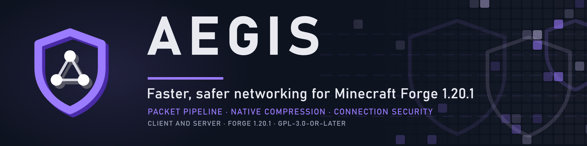
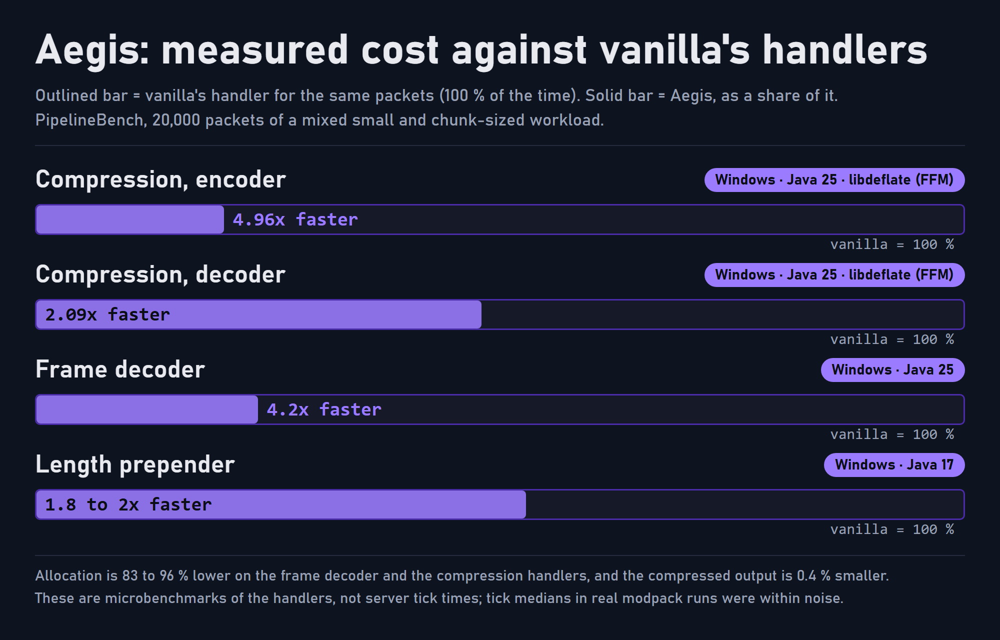

<p align="center">
  
</p>

# Aegis

Network stack optimisations, defect fixes and server-side connection hardening for Minecraft 1.20.1 (Forge 47.x).

Aegis consolidates and corrects the networking changes in [Krypton](https://github.com/astei/krypton), [VMP](https://github.com/RelativityMC/VMP-fabric) and [Packet Fixer](https://github.com/TonimatasDEV/PacketFixer), and adds per-address connection limiting, which vanilla 1.20.1 does not have. It registers no network channels and does not change the protocol.

Formerly RatNetworking, then Axial (before 0.5.0).

## Deployment

Aegis is optional on each side and wire-compatible with vanilla and with Aegis-less peers.

| Side | Components that apply |
|---|---|
| Server | All components |
| Client | Frame decoder and length prepender, compression, packet limits, timeouts, buffer-leak fixes |

Server-only: flush consolidation, entity tracking changes, non-blocking disconnect, connection throttle, offence bans and the block log.

## Components

Items marked † are experimental. Each is benchmarked first, ships disabled, and is removed if it does not pay off.

### Framing and compression

- **Frame decoder.** Replaces `Varint21FrameDecoder`. Emits retained slices of the cumulation buffer instead of copying each frame. Consumes runs of zero-length frames ("nullping") in one pass. Rejects an oversized frame from its length prefix, before buffering the body.
- **Length prepender.** Writes the length prefix as a separate buffer instead of copying the payload into a new one.
- **Compression.** libdeflate where available, `java.util.zip` otherwise. Level is configurable (default 6).

  | Platform | Backend |
  |---|---|
  | Linux x86_64 / aarch64, macOS arm64 | libdeflate via velocity-native (JNI) |
  | Windows x64, Java 22+ | libdeflate 1.26 via the FFM API |
  | Other | `java.util.zip` |

  A native load failure falls back to `java.util.zip` and logs once. `pipeline.natives=false` disables native code.
- **VarInt size** from a lookup table. Per-packet allocation in the frame decoder and the compression handlers is 83-96 % lower than vanilla.

### Flushing and the server tick

- **Flush consolidation.** While a level ticks chunks and entity trackers, and during a player's chunk load, flushes on remote connections are held and issued once per connection. Writes are still queued immediately and in order, so only the socket write is batched. A held flush is released early at 64 KiB pending. Writes made without a flush (some mods) are flushed on the next network tick.
- **Non-blocking disconnect.** `Connection.disconnect` no longer blocks the calling thread on `awaitUninterruptibly()` for remote server-side connections. Client and in-memory connections keep vanilla behaviour.
- **Entity tracker pre-check.** Skips `ChunkMap.TrackedEntity#updatePlayer` calls that can only be no-ops: the player is not in `seenBy` and, horizontally, both the player and its camera entity are beyond `viewDistance * 16`. Results are identical to vanilla. Measuring from the camera keeps SecurityCraft cameras, Ars Nouveau scrying and Steam 'n' Rails conductor possession working.
- **Chunk entity lookup.** On chunk send, collects the tracked entities for that chunk from the level's entity sections instead of iterating every tracked entity in the dimension. Vanilla's loop still builds the packets. Falls back to the full scan when called off the server thread or if the lookup fails.
- **Broadcast memoisation†.** Compresses a broadcast packet once for all recipients, for an allowlist of vanilla packet types. Ships disabled, and only proceeds if instrumentation shows redundant compression is a significant share of network CPU.

### Packet limits, timeouts, defect fixes

- **Packet size limits.** Packet Fixer removes the limits in both directions, which lets an unauthenticated client force the server to buffer up to 2 GiB per connection and to allocate a packet's claimed decompressed size up front. Aegis instead sets:

  | Direction | Limit | Applies |
  |---|---|---|
  | Clientbound | 128 MiB | All protocol states (Forge syncs registries during login) |
  | Serverbound | 16 MiB | PLAY only. HANDSHAKE, STATUS and LOGIN keep vanilla's 2 MiB frame / 8 MiB uncompressed |

- **Decompression.** Rejects a declared uncompressed length above what deflate can produce (compressed length x 1032) before allocating. Inflate output must equal the declared length. Streams with a preset dictionary (FDICT) are rejected.
- **Timeouts.** Read timeout and login timeout default to 120 s. The read timeout applies from LOGIN onward on both sides. HANDSHAKE and STATUS keep vanilla's 30 s, so a dead server in the server list still times out as before. The keep-alive timeout defaults to 60 s, with keep-alives still sent every 15 s.
- **Login compression ordering.** Vanilla enables compression only after the socket accepts the Set Compression packet, but writes Login Success immediately. On a busy socket Login Success could go out uncompressed, and the client disconnected with "Badly compressed packet". Compression is now enabled immediately after Set Compression is written.
- **Compressor lifetime.** Fixes a leaked native compressor when the connection closes during compression setup, and frees the native memory of replaced deflaters immediately.
- **FDICT hang.** Velocity's Java inflate loop makes no progress on a stream with a preset dictionary and spins the Netty I/O thread at 100 % CPU, stalling every connection on that thread. Such packets are rejected before inflating.
- **Buffer ownership.** Login queries and custom payloads are copied to heap buffers so the originals are released.

### Server security

All of this applies to real network connections only, never to singleplayer's in-memory connection. Full reference: [`docs/security.md`](docs/security.md).

- **Connection throttle.** Per source address: a token bucket of 10 new connections, refilled at 10 per 3 s, and at most 8 concurrent connections that have not reached PLAY. A connection over either limit is closed on accept, before any decoding. Loopback and `security.trustedAddresses` (addresses or CIDR) are exempt. IPv6 is keyed on /64. The table is capped at 65,536 tracked addresses; beyond that new addresses pass unthrottled, which bounds memory during a flood.
- **Offence bans.** A source address is refused for 60 s (`security.offenceBanSeconds`) after any of: malformed frame length, frame over the limit, impossible compressed header or declared size (decompression bomb), preset-dictionary stream. Conforming clients do not send these.
- **Log rate limiting.** One log line per address and reason per minute, with a repeat count.
- **Block log** (`security.blockLog`, off by default). Writes `logs/aegis-security.log` from a background thread, at most one line per address and reason every 10 s, in a fixed format. Example fail2ban filter and jail are in [`docs/fail2ban/`](docs/fail2ban/); the same file works with CrowdSec. Firewall changes stay outside the game process.
- **Proxy detection.** The throttle and block log disable themselves when Proxy-Compatible-Forge, BungeeForge or FabricProxy-Lite is present, since every player then shares the proxy's address. For other proxies, load balancers or NAT, add the address to `security.trustedAddresses`.

### Compatibility

- Modules that overlap with Packet Fixer, Connectivity, VMP or Immersive Portals disable themselves when those mods are present. `/aegis` (op) lists active modules, native backends, limits and notes.
- Tested on the All the Mods 9, Better MC 4 and Valhelsia 6 server packs and the RatPack 2.9 server, on Java 17 and 25.

## Performance

A change ships only if a benchmark or an in-game test shows it is faster. Rejected candidates and the reason for each are recorded under "Not adopted" in [`changelog.txt`](changelog.txt).

<p align="center">
  
</p>

Figures are from PipelineBench, the project's microbenchmark: 20,000 packets, mixed small and chunk-sized, run against vanilla's handlers on Windows with Temurin 25 unless noted. They measure handler cost, not server tick time or client frame rate.

| Area | Result |
|---|---|
| Compression | libdeflate vs vanilla, Windows / Java 25 (FFM): encoder 4.96x, decoder 2.09x. Linux / velocity-native (JNI): 4.4x and 1.9x. Output is 0.4 % smaller than `java.util.zip` at level 6 |
| Framing | Frame decoder 4.2x (Java 25) and 1.7x (Java 17). Length prepender 1.8-2x (Windows, Java 17). VarInt size about 10x |
| Flushing | One flush per connection per tick instead of one per packet. Cost: one volatile read per connection per tick |
| Overhead | `VarInts.write` is about 1 ns per packet slower than vanilla's; it is used only for Aegis's own length prefix |
| Server tick | No improvement measured. All the Mods 9, single one-minute run per setup: median 14.7 ms (shipped, with Packet Fixer) vs 14.9 ms (Aegis in its place); p95 32.1 ms vs 38.0 ms. With one run each, treat these as noise |
| Pre-auth frame limit | A STATUS connection announcing a 200 MiB frame stayed open 15 s or longer under Packet Fixer. Aegis closes it in about 3 ms |

## Roadmap

| Release | Scope |
|---|---|
| 0.1.x | Krypton, VMP and Packet Fixer merged and corrected. Compatibility fixes for large packs |
| 0.2.x | Login compression ordering, compressor leak, read timeout scope, flush safety net, chunk lookup guard |
| 0.3.0 | Connection throttle, offence bans, block log, fail2ban files |
| 0.4.0 | Java 25 audit, libdeflate on Windows via FFM |
| 0.5.x (current: 0.5.3) | Rename from Axial, new logo |
| Next | Broadcast memoisation†, gated on instrumentation |

Each release has a measure-first gate. An item that fails it is dropped and recorded in the changelog. No dates are committed.

Not planned:

- **io_uring transport.** Minecraft 1.20.1 ships Netty 4.1.82, shared by every mod; the io_uring transport needs Netty 4.2. Research only.
- **TCP_QUICKACK.** Linux clears it after the next ACK, so setting it once per socket has little effect.
- **Replacing velocity-native's JNI.** JNI only produces a warning on Java 24+.

## Requirements

- Minecraft 1.20.1, Forge 47.x
- Java 17 or newer. Native compression on Windows needs Java 22+. Java 24+ prints a native-access warning; `--illegal-native-access=allow` suppresses it (see [`docs/java.md`](docs/java.md)).
- Incompatible with Krypton forks that bundle velocity-native (Krypton Reforged, Krypton Reno): two modules export `com.velocitypowered.natives` and module resolution fails. Also incompatible with the old Axial and RatNetworking jars, which patch the same code. Forge stops at load with a message naming the conflicting mod.

## Installation

1. Remove Krypton Reforged / Krypton Reno, Axial / RatNetworking, and optionally Packet Fixer. If Packet Fixer stays, Aegis disables its overlapping modules.
2. Put `aegis-1.20.1-<version>.jar` in `mods` on the server, the clients, or both.
3. Configuration is `config/aegis.properties`. On first start it is seeded from `axial.properties` or `ratnetworking.properties` if either exists. Every module has an on/off switch.

## Building

```bash
./gradlew build
```

Requires JDK 17. Output: `build/libs/aegis-1.20.1-<version>.jar`. `./gradlew test` runs the unit tests with Netty's leak detector at `paranoid`.

## Licence and attribution

Aegis is GPL-3.0-or-later ([`LICENSE`](LICENSE)). Copyright (C) 2026 SolarBiscuit.

Derived or bundled components. Licence texts are in [`licenses/`](licenses/) and the jar; [`NOTICE`](NOTICE) lists what is used from each.

| Component | Author | Licence | Use |
|---|---|---|---|
| Krypton | Andrew Steinborn and contributors | LGPL-3.0 | Derived code |
| VMP | ishland | MIT | Derived code |
| Packet Fixer | TonimatasDEV | MIT | Derived code |
| velocity-native 3.4.0 | Velocity contributors | GPL-3.0 | Bundled unmodified (jar-in-jar). Contains libdeflate and links against the system OpenSSL |
| libdeflate 1.26 | Eric Biggers, Google LLC | MIT | Bundled unmodified (official Windows x86_64 build) |

Aegis is an independent project, not affiliated with or endorsed by Mojang Studios, Microsoft, Minecraft Forge, or the authors above.

## Issues

[Aegis issue tracker](https://github.com/SolarBiscuit/AegisNetworking/issues). Include the Aegis and Java versions, the other networking mods installed, `latest.log` and the output of `/aegis`.
